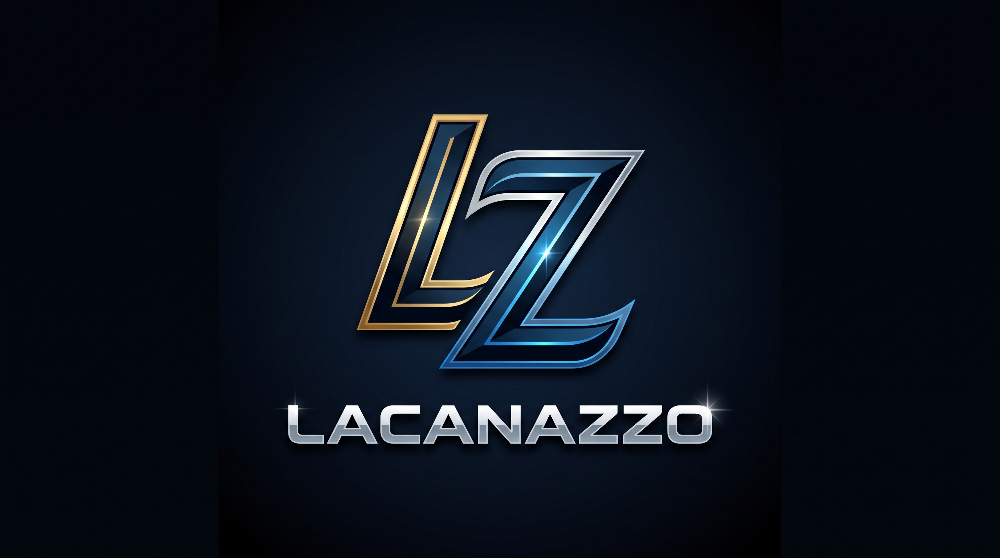

  

  # Simulador Avanzado de CPU y Jerarquía de Memoria de 8 Bits
  ### Proyecto Académico — Parcial 2 (Arquitectura de Computadoras)
  **Equipo LACANASSO** | **Universidad Católica Boliviana (UCB)**

  
  

---

## 🌐 Selección de Idioma / Language Selection

Toda la documentación arquitectónica detallada, diagramas **Mermaid** del ciclo de instrucción (`Fetch-Decode-Execute-Store`), jerarquía de memoria (`L1I`, `L1D`, `L2`, `MMU`, `Swap`), mapeo de periféricos de E/S y manual de usuario se encuentran disponibles en la carpeta [`/docs`](docs/):

* 🇧🇴 **Español:** [**Leer Documentación Técnica Completa (`docs/README.md`)**](docs/README.md)
* 🇺🇸 **English:** [**Read Full Technical Documentation (`docs/README_EN.md`)**](docs/README_EN.md)

---

## 🏗️ Estructura del Repositorio / Repository Structure

| Archivo / Ruta | Responsable | Descripción Técnica |
| :--- | :--- | :--- |
| [`01_Config_Y_Buses.gs`](01_Config_Y_Buses.gs) | David Torrico | Configuración maestra (`UI_CONFIG`), buses tri-estado (`High-Z`), 18 señales de micro-palabra, ALU de 8 bits con monitor binario y banderas (`ZF`, `CF`, `SF`). |
| [`02_Memoria_Y_Virtual.gs`](02_Memoria_Y_Virtual.gs) | Jorge Aguilera | RAM física de 256B (8 marcos de 32B), Memoria Virtual paginada de 512B (16 páginas), traductor MMU ($PA = PFN \times 32 + Offset$), manejo de *Page Faults* y reemplazo `FIFO`/`LRU` con *Write-Back*. |
| [`03_Cache_Jerarquia.gs`](03_Cache_Jerarquia.gs) | Jorge Aguilera | Caché multinivel Harvard/Unificada (`L1I`, `L1D` y `L2`) con políticas *Write-Allocate*, invalidación cruzada y cálculo de *Hit/Miss Rate*. |
| [`04_Perifericos_Y_Control.gs`](04_Perifericos_Y_Control.gs) | David Torrico | Unidad de Control, ciclo de instrucción de 4 fases, periféricos mapeados en el `Marco 7` (`IN`/`OUT`, Cola FIFO Teclado `F0h-F7h` y VRAM LCD 8x1 `F8h-FFh`), Ensamblador de 2 pasadas y catálogo de 3 programas. |
| [`05_Constructor_Diseno_UI.gs`](05_Constructor_Diseno_UI.gs) | Jorge & David | Menú interactivo superior (`onOpen`) y ayudantes de formato visual de paneles en Google Sheets. |
| [`docs/README.md`](docs/README.md) | David Torrico | Manual técnico y arquitectónico completo en **Español** con diagramas Mermaid. |
| [`docs/README_EN.md`](docs/README_EN.md) | David Torrico | Full technical and architectural manual in **English** with Mermaid diagrams. |

---

## 👥 Autores y División de Módulos (Gitflow & Kanban)

* **David Rodrigo Torrico Vera (`@DavidTorricoVe`)** — *CPU Core, ALU 8-Bit, Buses Tri-Estado, Micro-Palabra (18 señales), Periféricos de E/S (`IN`/`OUT`), IDE Ensamblador de 2 Pasadas y Documentación Bilingüe.*
* **Jorge (`@jorgeagch`)** — *Memoria Física (8 Marcos), Memoria Virtual (16 Páginas y Swap), Traductor MMU, Algoritmos `FIFO`/`LRU` con Write-Back, Jerarquía de Caché (`L1I`, `L1D`, `L2`) y Pruebas QA.*
