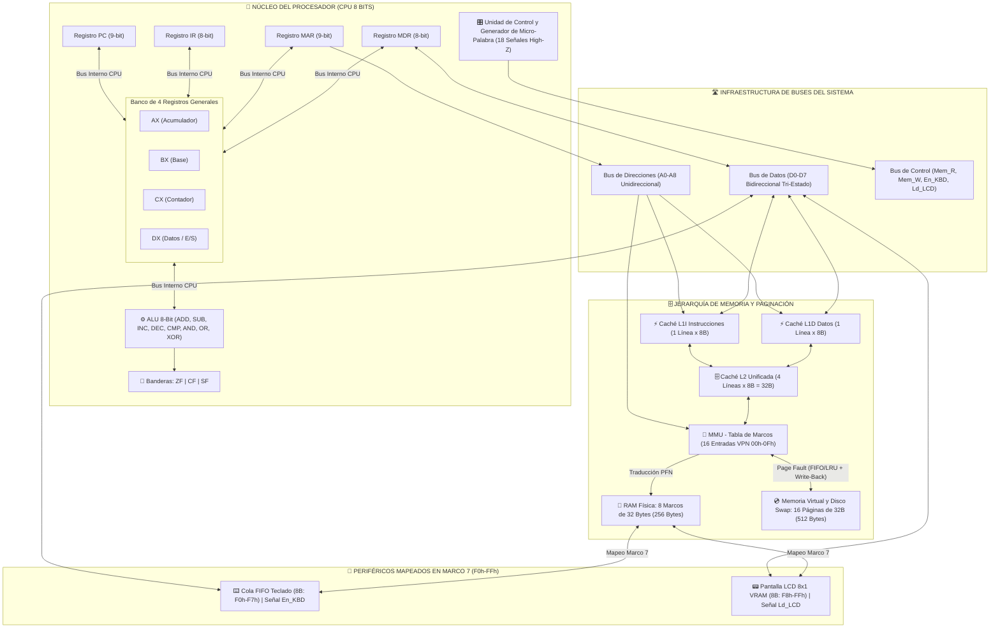
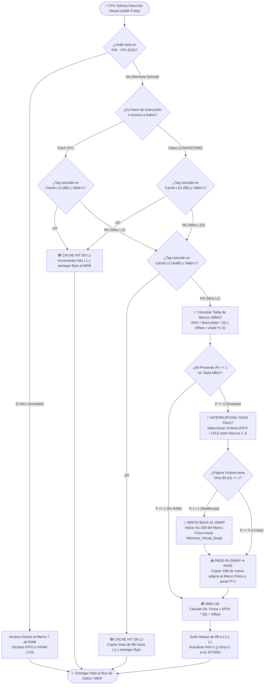
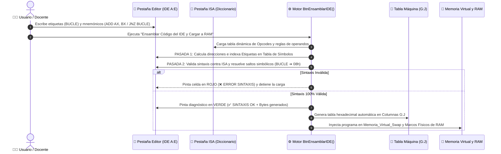

# ⚡ Simulador Avanzado de CPU y Jerarquía de Memoria de 8 Bits (Parcial 2)

> **Equipo:** **LACANASSO**  
> **Asignatura:** Arquitectura de Computadoras  
> **Integrantes:**  
> - **David Torrico** (`@DavidTorricoVe`) — *Arquitectura CPU, ALU 8-Bit, Buses Tri-Estado (High-Z), Periféricos E/S, IDE Ensamblador de 2 Pasadas y Documentación.*  
> - **Jorge** (`@jorgeagch`) — *RAM Paginada en 8 Marcos, Memoria Virtual (512B) y Swap, Unidad de Gestión de Memoria (MMU), Page Fault Handler, Jerarquía de Caché (L1I, L1D, L2), Ergonomía de Menú UI y QA.*  
>
> 🔗 **Enlace al Simulador Interactivo en Google Sheets:** [https://docs.google.com/spreadsheets/d/1GSkjrYjDr-xYP_vY09SOu5YP6mDYAkPklD_ZkgIGQ4E/edit?usp=sharing]  

> 🌐 **English Version:** [Read Technical Documentation in English (`README_EN.md`)](./README_EN.md)

---

## 📋 Índice de Contenidos
1. [Resumen Ejecutivo del Proyecto](#1-resumen-ejecutivo-del-proyecto)
2. [Diagramas de Arquitectura del Sistema (Mermaid)](#2-diagramas-de-arquitectura-del-sistema-mermaid)
3. [Arquitectura Modular de 5 Archivos en Google Apps Script (Cero Hardcoding)](#3-arquitectura-modular-de-5-archivos-en-google-apps-script-cero-hardcoding)
4. [Especificación Matemática de la Jerarquía de Memoria y MMU](#4-especificación-matemática-de-la-jerarquía-de-memoria-y-mmu)
5. [Micro-Palabra de Control (18 Señales) y Buffers Tri-Estado (High-Z)](#5-micro-palabra-de-control-18-señales-y-buffers-tri-estado-high-z)
6. [Periféricos Mapeados en Memoria (Memory-Mapped I/O)](#6-periféricos-mapeados-en-memoria-memory-mapped-io)
7. [IDE Ensamblador de Dos Pasadas y Verificador de Sintaxis](#7-ide-ensamblador-de-dos-pasadas-y-verificador-de-sintaxis)
8. [Repertorio de Instrucciones Dinámico (Tabla ISA)](#8-repertorio-de-instrucciones-dinámico-tabla-isa)
9. [Catálogo de los 3 Programas Demostrativos Oficiales](#9-catálogo-de-los-3-programas-demostrativos-oficiales)
10. [Manual de Uso y Ejecución Paso a Paso](#10-manual-de-uso-y-ejecución-paso-a-paso)

---

## 1. Resumen Ejecutivo del Proyecto

El **Simulador Avanzado de CPU y Memoria de 8 Bits — Equipo Lacanasso** es un entorno de hardware virtualizado e interactivo desarrollado sobre **Google Sheets** y **Google Apps Script**. Evoluciona la arquitectura base del Parcial 1 hacia un computador completo con jerarquía de memoria multinivel, paginación bajo demanda y entrada/salida mapeada en memoria, respetando estrictamente el principio de **Cero Hardcoding (100% conducido por tablas)**.

### Características Principales Implementadas:
* **CPU de 8 Bits con 4 Registros de Propósito General:** Incorpora los registros `AX` (Acumulador), `BX` (Base), `CX` (Contador de bucles) y `DX` (Datos e E/S), junto con los registros de sistema `PC` ($9\text{ bits}$ virtuales), `IR`, `MAR` ($9\text{ bits}$) y `MDR`, más el registro de estado con banderas `ZF` (*Zero Flag*), `CF` (*Carry Flag*) y `SF` (*Sign Flag*).
* **Unidad Aritmético-Lógica (ALU) con Monitor Binario en Vivo:** Soporta `ADD`, `SUB`, `INC`, `DEC`, `CMP`, `AND`, `OR` y `XOR`, mostrando en tiempo real las entradas, el resultado hexadecimal/decimal y la operación en binario de $8\text{ bits}$.
* **Infraestructura de 4 Buses Independientes y 18 Señales Tri-Estado (`High-Z`):** Separa el **Bus Interno del CPU**, **Bus de Direcciones**, **Bus de Datos** y **Bus de Control**, gobernados por una micro-palabra de $18\text{ señales}$ que valida físicamente la existencia de un único emisor activo por micro-operación.
* **Jerarquía de Memoria Caché Multinivel:** Nivel 1 con arquitectura **Harvard separada** (`L1I` de $8\text{ Bytes}$ para instrucciones y `L1D` de $8\text{ Bytes}$ para datos) y Nivel 2 **Unificado** (`L2` de $32\text{ Bytes}$ organizada en $4\text{ líneas}$ de $8\text{ Bytes}$), con cálculo automático de `Hits`, `Misses` y `Hit Rate (%)`.
* **Memoria Física en 8 Marcos y Memoria Virtual Paginada (Swap):** Memoria RAM principal de $256\text{ Bytes}$ dividida en **$8\text{ Marcos de Página}$ (`Marco 0` a `Marco 7`) de $32\text{ Bytes}$**, respaldada por un espacio de **Memoria Virtual de $512\text{ Bytes}$ ($16\text{ Páginas Virtuales}$ de $32\text{ Bytes}$)** alojado en la pestaña `Memoria_Virtual_Swap`.
* **Unidad de Gestión de Memoria (MMU) e Interrupción de `Page Fault`:** Traducción automática de direcciones virtuales de $9\text{ bits}$ a direcciones físicas de $8\text{ bits}$, detección de páginas ausentes ($\text{Bit } P = 0$), alerta visual de interrupción en rojo y algoritmos de reemplazo configurables (**`FIFO`** y **`LRU`**) con política *Write-Back* al área de Swap cuando $\text{Dirty Bit} = 1$.
* **Periféricos Interactivos de E/S Mapeados en el `Marco 7`:** Cola circular **FIFO de Teclado de $8\text{ Bytes}$** (`F0h`–`F7h`, controlada por `En_KBD` e instrucción `IN`) y **Buffer de Video VRAM de $8\text{ Bytes}$** (`F8h`–`FFh`, controlado por `Ld_LCD` e instrucción `OUT`) conectado a una **Pantalla LCD Alfanumérica $8\times 1$**.

---

## 2. Diagramas de Arquitectura del Sistema (Mermaid)

### 2.1. Arquitectura General del Procesador, Buses y Periféricos

### 2.2. Flujo de Consulta en Caché Multinivel y Manejo de Fallo de Página (MMU)

### 2.3. Flujo del Ensamblador IDE de Dos Pasadas (2-Pass Assembler)

---

## 3. Arquitectura Modular de 5 Archivos en Google Apps Script (Cero Hardcoding)

El código fuente del proyecto está estructurado en **5 módulos `.gs` independientes** que comparten el diccionario centralizado `UI_CONFIG`:

| Archivo `.gs` | Responsable | Issues | Propósito y Componentes que Administra |
| :--- | :---: | :---: | :--- |
| **`01_Config_Y_Buses.gs`** | David | #1–#4 | Define `UI_CONFIG` (coordenadas de las 4 hojas y paleta de colores corporativa), estado de los 8 registros (`PC`, `IR`, `MAR`, `MDR`, `AX`, `BX`, `CX`, `DX`), banderas (`ZF`, `CF`, `SF`), la ALU de 8 bits con monitor binario, el motor anti-timeout `SmartWait`/`TURBO_MODE` y el validador de las 18 señales `High-Z`. |
| **`02_Memoria_Y_Virtual.gs`** | Jorge | #5–#8 | Administra el acceso físico a los **8 Marcos de RAM** ($256\text{ B}$), las **16 Páginas de Memoria Virtual y Swap** ($512\text{ B}$), el traductor matemático `MMU_Translate()`, el manejador de interrupción `HandlePageFault()` con reemplazo **`FIFO`/`LRU`** y la bitácora de *Write-Back*. |
| **`03_Cache_Jerarquia.gs`** | Jorge | #9–#10 | Controla la jerarquía de caché multinivel (`L1I` de $8\text{ B}$, `L1D` de $8\text{ B}$ y `L2` de $32\text{ B}$), la política *Write-Allocate* / *Write-Through* y el cálculo en vivo de `Hits`, `Misses` y `Hit Rate (%)`. |
| **`04_Perifericos_Y_Control.gs`** | David & Jorge | #11–#16 | Implementa los periféricos mapeados en memoria (Cola FIFO de Teclado en `F0h`–`F7h` y Pantalla LCD $8\times 1$ en `F8h`–`FFh`), el **Ensamblador IDE de Dos Pasadas**, el **Verificador de Sintaxis ISA**, el ciclo de instrucción conducido por tabla (`Fetch`, `Decode`, `Execute`, `Store`), los controles de ejecución (`Step`, `Run`, `Pause`, `Reset`) y los 3 programas del catálogo. |
| **`05_Constructor_Diseno_UI.gs`** | Jorge & David | #1, #16 | Integra el menú superior interactivo `onOpen()` (`⚡ SIMULADOR LACANASSO`), los ayudantes de estilo de tarjetas `StyleCard()` y la función de sincronización visual de buses y paneles de la consola. |

---

## 4. Especificación Matemática de la Jerarquía de Memoria y MMU

### 4.1. Traducción de Direcciones Virtuales a Físicas (MMU)
El procesador opera con direcciones virtuales de $9\text{ bits}$ ($\text{VAddr} \in [0, 511]$, o $\text{000h}$ a $\text{1FFh}$), mientras que la RAM física posee $8\text{ bits}$ de direccionamiento ($\text{PAddr} \in [0, 255]$, o $\text{00h}$ a $\text{FFh}$). Dado un tamaño de página y de marco fijo de $32\text{ Bytes}$ ($2^5\text{ Bytes}$):

$$\text{VPN (Número de Página Virtual)} = \left\lfloor \frac{\text{VAddr}}{32} \right\rfloor \quad \in [0, 15]$$

$$\text{Offset (Desplazamiento dentro de la Página)} = \text{VAddr} \bmod 32 \quad \in [0, 31]$$

Si en la Tabla de Marcos el bit de presencia cumple $P = 1$, la dirección física final de $8\text{ bits}$ se obtiene a partir del Marco de Página Físico asignado ($\text{PFN} \in [0, 7]$):

$$\text{PAddr (Dirección Física)} = (\text{PFN} \times 32) + \text{Offset}$$

### 4.2. Direccionamiento de Líneas de Caché ($L1I$, $L1D$ y $L2$)
Cada línea de caché almacena un bloque contiguo de $8\text{ Bytes}$:

$$\text{Tag (Etiqueta de Bloque)} = \left\lfloor \frac{\text{VAddr}}{8} \right\rfloor, \qquad \text{Byte Offset} = \text{VAddr} \bmod 8 \quad \in [0, 7]$$

Para la caché unificada $L2$ ($32\text{ Bytes} = 4\text{ líneas de } 8\text{ Bytes}$), el índice de línea se determina por correspondencia modular:

$$\text{Índice de Línea } L2 = \text{Tag} \bmod 4 \quad \in \{0, 1, 2, 3\}$$

$$\text{Hit Rate (\%)} = \left( \frac{\text{Hits}}{\text{Hits} + \text{Misses}} \right) \times 100\%$$

---

## 5. Micro-Palabra de Control (18 Señales) y Buffers Tri-Estado (`High-Z`)

En cada micro-operación del ciclo de instrucción, el vector de control en el rango `A25:D42` de `Hoja 1` conmuta sus celdas entre **`1`** (activo, en verde `#00E676`) y **`Hi-Z`** (alta impedancia, en gris `#E2E8F0`), garantizando que nunca existan dos emisores simultáneos en el bus:

| ID | Señal | Tipo de Componente | Función Física en el Hardware |
| :---: | :---: | :---: | :--- |
| `S01` | **`En_PC`** | Buffer Tri-Z (Emisor) | Coloca el contenido del contador de programa `PC` en el Bus Interno. |
| `S02` | **`Ld_MAR`** | Latch Carga | Captura el valor presente en el bus dentro del registro de direcciones `MAR`. |
| `S03` | **`Mem_R`** | Bus Control | Ordena una operación de lectura a la jerarquía Caché / MMU / RAM. |
| `S04` | **`Mem_W`** | Bus Control | Ordena una operación de escritura en Caché / MMU / RAM (activa `Dirty=1`). |
| `S05` | **`Ld_MDR`** | Latch Carga | Carga en `MDR` el byte proveniente del Bus de Datos o del Bus Interno. |
| `S06` | **`En_MDR`** | Buffer Tri-Z (Emisor) | Libera el dato de `MDR` hacia el Bus de Datos o el Bus Interno. |
| `S07` | **`Ld_IR`** | Latch Carga | Carga el opcode actual desde el bus hacia el registro de instrucción `IR`. |
| `S08` | **`En_ALU`** | Buffer Tri-Z (Emisor) | Coloca el resultado procesado por la ALU de 8 bits en el Bus Interno. |
| `S09` | **`Ld_AX`** | Latch Carga | Carga el byte del bus en el registro acumulador `AX`. |
| `S10` | **`En_AX`** | Buffer Tri-Z (Emisor) | Libera el valor de `AX` hacia el bus. |
| `S11` | **`Ld_BX`** | Latch Carga | Carga el byte del bus en el registro base `BX`. |
| `S12` | **`En_BX`** | Buffer Tri-Z (Emisor) | Libera el valor de `BX` hacia el bus. |
| `S13` | **`Ld_CX`** | Latch Carga | Carga el byte del bus en el registro contador `CX`. |
| `S14` | **`En_CX`** | Buffer Tri-Z (Emisor) | Libera el valor de `CX` hacia el bus. |
| `S15` | **`Ld_DX`** | Latch Carga | Carga el byte del bus en el registro de datos `DX`. |
| `S16` | **`En_DX`** | Buffer Tri-Z (Emisor) | Libera el valor de `DX` hacia el bus. |
| `S17` | **`En_KBD`** | Buffer E/S | Desencola el primer carácter ASCII del Teclado FIFO (`F0h`) hacia el Bus de Datos. |
| `S18` | **`Ld_LCD`** | Latch E/S | Captura el byte del Bus de Datos en la VRAM (`F8h`–`FFh`) y enciende el display LCD $8\times 1$. |

---

## 6. Periféricos Mapeados en Memoria (Memory-Mapped I/O)

El **`Marco 7`** de la RAM física (direcciones `E0h` a `FFh`) está reservado para la interfaz de Entrada/Salida mapeada en memoria:
1. **Teclado Alfanumérico con Cola FIFO de $8\text{ Bytes}$ (`F0h` a `F7h`):**
   * El usuario escribe hasta $8\text{ caracteres}$ en la celda `V19` de `Hoja 1` y ejecuta `BtnEnqueueKey`.
   * Cada carácter se convierte a su byte ASCII hexadecimal y se almacena en `F0h`–`F7h`.
   * Cuando el programa ejecuta `IN AX, [KBD]` (`50h`) o `IN DX, [KBD]` (`51h`), se activa `En_KBD = 1`, el byte en `F0h` viaja al registro destino y los $7\text{ bytes}$ restantes avanzan automáticamente una posición hacia la izquierda (`F1h` $\rightarrow$ `F0h`).
2. **Pantalla LCD Alfanumérica $8\times 1$ con VRAM de $8\text{ Bytes}$ (`F8h` a `FFh`):**
   * Cuando el programa ejecuta `OUT [LCD], AX` (`52h`) o `OUT [LCD], DX` (`53h`), se activa `Ld_LCD = 1`.
   * El byte del registro se escribe en la siguiente posición disponible de la VRAM (`F8h` a `FFh`) y se renderiza como carácter ASCII brillante en el panel LCD `T22:AA22` junto con su registro en la bitácora de puertos E/S (`K39:P42`).

---

## 7. IDE Ensamblador de Dos Pasadas y Verificador de Sintaxis

En la pestaña **`Editor`**, el simulador ofrece un entorno de desarrollo dual:
* **Panel Izquierdo (`Columnas A a E` — IDE de Alto Nivel):** Permite escribir código ensamblador utilizando mnemónicos en texto y **etiquetas simbólicas** (ej. `INICIO`, `BUCLE`, `LOOP_IO`).
  * **Pasada 1:** Calcula el contador de ubicación de cada línea ($1\text{ byte}$ para instrucciones sin operando y $2\text{ bytes}$ para instrucciones con operando inmediato/dirección) y construye la Tabla de Símbolos con la dirección exacta de cada etiqueta.
  * **Pasada 2:** Verifica que cada instrucción exista en la pestaña `ISA`, reemplaza las etiquetas por sus direcciones hexadecimales calculadas y genera el diagnóstico visual en la Columna E (`✅ SINTAXIS OK` en verde o `❌ ERROR SINTAXIS` en rojo).
* **Panel Central (`Columnas G a J` — Tabla de Código Máquina Hexadecimal):** Recibe automáticamente los bytes ensamblados por el IDE o permite ingresar direcciones y valores hexadecimales de forma manual (100% compatible con la modalidad del Parcial 1).

---

## 8. Repertorio de Instrucciones Dinámico (Tabla ISA)

El decodificador `Decode()` y el ejecutor `Execute()` consultan en tiempo de ejecución la pestaña **`ISA`** sin ningún opcode fijo en el código JavaScript:

| Opcode (Hex) | Mnemónico | Tipo de Ciclo | Op. ALU | Reg. Destino | Reg. Origen | ¿Tiene Operando? | Condición Salto | Señales Activas Principales |
| :---: | :--- | :---: | :---: | :---: | :---: | :---: | :---: | :--- |
| `00` | `NOP` | `NOP` | `NONE` | `NONE` | `NONE` | `FALSE` | `NONE` | Ninguna |
| `10`..`13` | `MOV AX/BX/CX/DX, imm` | `MOV_IMM` | `NONE` | `AX`..`DX` | `IMM` | `TRUE` | `NONE` | `En_MDR, Ld_Reg` |
| `14`..`19` | `MOV RegDest, RegOrig` | `MOV_REG` | `NONE` | `AX`..`DX` | `AX`..`DX` | `FALSE` | `NONE` | `En_Orig, Ld_Dest` |
| `20`, `21`, `26`, `27` | `LOAD AX/BX/CX/DX, [mem]` | `LOAD` | `NONE` | `AX`..`DX` | `MEM` | `TRUE` | `NONE` | `Ld_MAR, Mem_R, Ld_Reg` |
| `24`, `25`, `2A`, `2B` | `STORE [mem], AX/BX/CX/DX` | `STORE` | `NONE` | `MEM` | `AX`..`DX` | `TRUE` | `NONE` | `En_Reg, Ld_MDR, Mem_W` |
| `28` | `VLOAD DX, [vpn]` | `VLOAD` | `NONE` | `DX` | `MEM` | `TRUE` | `NONE` | `Ld_MAR, Mem_R, Ld_DX` |
| `29` | `VSTORE [vpn], AX` | `VSTORE` | `NONE` | `MEM` | `AX` | `TRUE` | `NONE` | `En_AX, Ld_MDR, Mem_W` |
| `22` | `SUB AX, imm` | `ALU_IMM` | `SUB` | `AX` | `IMM` | `TRUE` | `NONE` | `En_ALU, Ld_AX` |
| `23` | `DEC CX` | `ALU_UNARY` | `DEC` | `CX` | `NONE` | `FALSE` | `NONE` | `En_ALU, Ld_CX` |
| `30` | `ADD AX, BX` | `ALU_REG` | `ADD` | `AX` | `BX` | `FALSE` | `NONE` | `En_ALU, Ld_AX` |
| `3A` | `SUB AX, DX` | `ALU_REG` | `SUB` | `AX` | `DX` | `FALSE` | `NONE` | `En_ALU, Ld_AX` |
| `34`..`3F` | `INC / DEC / CMP / AND / XOR` | `ALU_*` | `INC`..`XOR` | `AX`..`DX` | `BX`/`IMM` | `VAR` | `NONE` | `En_ALU, Ld_Reg` |
| `40` | `JMP addr` | `JMP` | `NONE` | `PC` | `IMM` | `TRUE` | `ALWAYS` | `En_ALU, Ld_PC` |
| `31`, `32`, `43` | `JZ / JNZ / JC addr` | `JCC` | `NONE` | `PC` | `IMM` | `TRUE` | `ZF=1 / ZF=0 / CF=1` | `En_ALU` |
| `50`, `51` | `IN AX/DX, [KBD]` | `IN_KBD` | `NONE` | `AX`/`DX` | `KBD` | `FALSE` | `NONE` | `En_KBD, Ld_Reg` |
| `52`, `53` | `OUT [LCD], AX/DX` | `OUT_LCD` | `NONE` | `LCD` | `AX`/`DX` | `FALSE` | `NONE` | `En_Reg, Ld_LCD` |
| `FF` | `HLT` | `HLT` | `NONE` | `NONE` | `NONE` | `FALSE` | `NONE` | Detiene el Reloj |

---

## 9. Catálogo de los 3 Programas Demostrativos Oficiales

Desde el panel de control o el menú **`⚡ SIMULADOR LACANASSO`** se puede precargar, ensamblar e inyectar en RAM cualquiera de los 3 algoritmos exigidos por la rúbrica:

### 9.1. Programa 1: Cálculo Aritmético Iterativo con Bucles y 4 Registros (`AX`, `BX`, `CX`, `DX`)
* **Objetivo:** Demostrar el uso coordinado de los 4 registros generales, la ALU de 8 bits, las banderas (`ZF`) y los saltos condicionales (`JNZ`).
* **Traza de Ejecución:** Inicializa `AX = 00h`, `BX = 06h`, `CX = 04h` (4 vueltas) y `DX = 02h`. En cada iteración del bucle (`BUCLE` en `08h`) suma `ADD AX, BX`, incrementa `INC DX` y decrementa `DEC CX` saltando con `JNZ BUCLE` mientras $\text{ZF} = 0$. Al terminar las 4 vueltas ($\text{AX} = \text{18h} = 24_{10}$, $\text{DX} = \text{06h} = 6_{10}$, $\text{CX} = \text{00h}$), ejecuta la resta `SUB AX, DX` obteniendo $\text{AX} = \text{12h}$ ($18_{10}$), almacena el resultado en `80h` (`Marco 4`, activando `Dirty = 1`) y se detiene con `HLT`.

### 9.2. Programa 2: Eco Interactivo de Entrada/Salida (Teclado FIFO $\rightarrow$ Pantalla LCD $8\times 1$)
* **Objetivo:** Demostrar la comunicación por **Memory-Mapped I/O** entre la cola FIFO del teclado (`F0h`–`F7h`), los registros del CPU y la pantalla LCD $8\times 1$ (`F8h`–`FFh`).
* **Traza de Ejecución:** Encola la cadena `"HOLA!"` ($5\text{ caracteres}$) en el `Marco 7`. Configura el contador `CX = 05h` y ejecuta un bucle que desencola cada carácter con `IN DX, [KBD]` (`En_KBD = 1`), lo copia a `AX` con `MOV AX, DX`, lo envía al display con `OUT [LCD], DX` (`Ld_LCD = 1`) y repite con `DEC CX` + `JNZ LOOP_IO` hasta encender `"H O L A !"` en verde neón en el display LCD.

### 9.3. Programa 3: Estrés de Jerarquía de Memoria (`Cache Miss/Hit` + `Page Faults` + `Write-Back`)
* **Objetivo:** Demostrar la localidad espacial en caché (`L1D`/`L2`), la interrupción de fallo de página (`Page Fault`) en la MMU y el volcado de páginas modificadas (`Dirty = 1`) hacia el área de Swap.
* **Traza de Ejecución:**
  1. Escribe `AAh` en la dirección `40h` (`STORE [40h], AX`), alojando el bloque en `L1D`/`L2` y marcando el `Marco 2` (`VPN 02h`) con **`Dirty Bit (D) = 1`**.
  2. Ejecuta dos lecturas contiguas (`LOAD BX, [40h]` y `LOAD CX, [41h]`) que producen **2 `CACHE HIT` inmediatos en `L1D`** (verde brillante).
  3. Ejecuta `VSTORE [Pág 08h], AX`: como la Página Virtual `08h` tiene **`Bit P = 0`** (en Swap), la MMU dispara en rojo **`🚨 PAGE FAULT EN VPN 08h`**, selecciona como víctima el `Marco 2` (`VPN 02h`), detecta que tiene **`Dirty = 1`** y ejecuta un **`WRITE-BACK`** copiando sus $32\text{ Bytes}$ de vuelta a `Memoria_Virtual_Swap` antes de cargar la página `08h`.
  4. Ejecuta `VLOAD DX, [Pág 0Ah]`: dispara un **segundo `PAGE FAULT`**, trae la Página Virtual `0Ah` desde el Swap hacia la RAM y carga el byte precargado **`99h`** dentro del registro `DX`.

---

## 10. Manual de Uso y Ejecución Paso a Paso

1. El libro de **Google Sheets** está organizado en 4 hojas: `Hoja 1` (Consola Principal de Hardware), `Memoria_Virtual_Swap` (16 Páginas Virtuales de $32\text{ B}$ y Bitácora de Swap), `ISA` (Tabla dinámica del repertorio de instrucciones) y `Editor` (IDE Ensamblador de 2 pasadas y cargador hexadecimal).
2. En **Extensiones $\rightarrow$ Apps Script** residen los 5 módulos de la arquitectura (`01_Config_Y_Buses.gs`, `02_Memoria_Y_Virtual.gs`, `03_Cache_Jerarquia.gs`, `04_Perifericos_Y_Control.gs` y `05_Constructor_Diseno_UI.gs`).
3. Selecciona cualquiera de los 3 programas del catálogo desde la pestaña `Editor` o el menú **`⚡ SIMULADOR LACANASSO`** (se ensamblan, validan e inyectan automáticamente en RAM).
4. Ejecuta con **`👣 STEP`** (`BtnStep`) para inspeccionar cada micro-operación animada por los buses o **`▶️ RUN`** (`BtnRun`) para corrida continua en Modo Turbo.