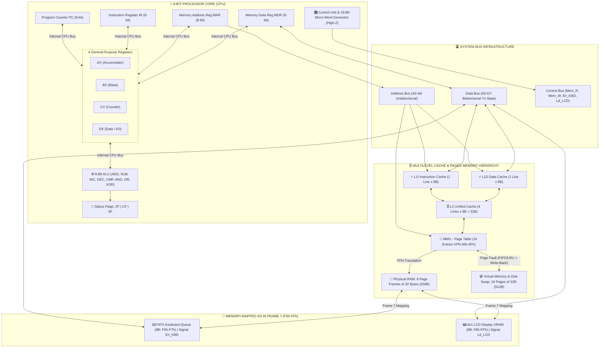
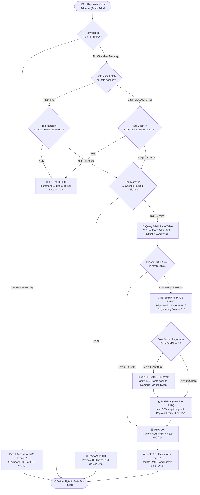

# ⚡ Advanced 8-Bit CPU and Memory Hierarchy Simulator (Midterm 2)

> **Team:** **LACANASSO**  
> **Course:** Computer Architecture  
> **Team Members:**  
> - **David Torrico** (`@DavidTorricoVe`) — *CPU Architecture, 8-Bit ALU, Tri-State Buses (High-Z), Memory-Mapped I/O Peripherals, 2-Pass IDE Assembler & Documentation.*  
> - **Jorge** (`@jorgeagch`) — *8-Frame Paged Physical RAM, 512B Virtual Memory & Swap Area, Memory Management Unit (MMU), Page Fault Handler, Multilevel Cache Hierarchy (L1I, L1D, L2), UI Menu Ergonomics & QA.*  
>
> 🔗 **Live Interactive Google Sheets Simulator:** https://docs.google.com/spreadsheets/d/1GSkjrYjDr-xYP_vY09SOu5YP6mDYAkPklD_ZkgIGQ4E/edit?usp=sharing

> 🌐 **Versión en Español:** [Leer Documentación Técnica en Español (`README.md`)](./README.md)

---

## 📋 Table of Contents
1. [Executive Summary](#1-executive-summary)
2. [System Architecture Diagrams (Mermaid)](#2-system-architecture-diagrams-mermaid)
3. [Modular 5-File Google Apps Script Architecture (Zero Hardcoding)](#3-modular-5-file-google-apps-script-architecture-zero-hardcoding)
4. [Mathematical Specification of the Memory Hierarchy and MMU](#4-mathematical-specification-of-the-memory-hierarchy-and-mmu)
5. [18-Signal Control Micro-Word and Tri-State Buffers (High-Z)](#5-18-signal-control-micro-word-and-tri-state-buffers-high-z)
6. [Memory-Mapped I/O Peripherals](#6-memory-mapped-io-peripherals)
7. [Two-Pass IDE Assembler and Syntax Checker](#7-two-pass-ide-assembler-and-syntax-checker)
8. [Dynamic Instruction Set Architecture (ISA Table)](#8-dynamic-instruction-set-architecture-isa-table)
9. [Catalog of the 3 Official Demonstration Programs](#9-catalog-of-the-3-official-demonstration-programs)
10. [User Manual and Step-by-Step Execution Guide](#10-user-manual-and-step-by-step-execution-guide)

---

## 1. Executive Summary

The **Advanced 8-Bit CPU and Memory Hierarchy Simulator — Team Lacanasso** is a fully interactive, hardware-accurate educational simulator built on **Google Sheets** and **Google Apps Script**. It expands the Midterm 1 Von Neumann baseline into a modern computer architecture featuring a multilevel Harvard/Unified cache hierarchy, demand paging with a virtual Swap space, and memory-mapped peripherals, strictly adhering to **Zero Hardcoding (100% Table-Driven Execution)**.

### Key Architectural Highlights:
* **8-Bit CPU with 4 General-Purpose Registers:** Features `AX` (Accumulator), `BX` (Base), `CX` (Loop Counter), and `DX` (Data / I/O), alongside system registers `PC` ($9\text{-bit}$ virtual), `IR`, `MAR` ($9\text{-bit}$), `MDR`, and status flags `ZF` (*Zero*), `CF` (*Carry*), and `SF` (*Sign*).
* **8-Bit Arithmetic Logic Unit (ALU) with Live Binary Monitor:** Executes `ADD`, `SUB`, `INC`, `DEC`, `CMP`, `AND`, `OR`, and `XOR`, displaying real-time operands, hexadecimal/decimal outputs, and $8\text{-bit}$ binary representations.
* **4 Independent System Buses & 18 Tri-State Signals (`High-Z`):** Visualizes the **Internal CPU Bus**, **Address Bus**, **Data Bus**, and **Control Bus**, governed by an $18\text{-signal}$ control micro-word that enforces single-emitter bus arbitration.
* **Multilevel Cache Hierarchy:** Split **Harvard Level 1** (`L1I` $8\text{ Bytes}$ for instructions, `L1D` $8\text{ Bytes}$ for data) backed by a **Unified Level 2** (`L2` $32\text{ Bytes}$ across $4\text{ lines}$ of $8\text{ Bytes}$), with real-time `Hits`, `Misses`, and `Hit Rate (%)` telemetry.
* **8-Frame Physical RAM & 512-Byte Paged Virtual Memory (Swap):** $256\text{ Bytes}$ of physical RAM partitioned into **$8\text{ Page Frames}$ (`Frame 0` to `Frame 7`) of $32\text{ Bytes}$**, backed by **$512\text{ Bytes}$ of Virtual Memory ($16\text{ Virtual Pages}$ of $32\text{ Bytes}$)** in the `Memoria_Virtual_Swap` tab.
* **Memory Management Unit (MMU) & `Page Fault` Interrupt Handler:** Translates $9\text{-bit}$ virtual addresses into $8\text{-bit}$ physical addresses, triggers a red visual interrupt upon accessing unmapped pages ($\text{Present Bit } P = 0$), and executes **`FIFO`** or **`LRU`** page replacement with automatic *Write-Back* to Swap when $\text{Dirty Bit} = 1$.
* **Memory-Mapped I/O Peripherals in `Frame 7`:** An **$8\text{-Byte}$ FIFO Keyboard Queue** (`F0h`–`F7h`, governed by `En_KBD` and `IN`) and an **$8\text{-Byte}$ Video RAM (VRAM) Buffer** (`F8h`–`FFh`, governed by `Ld_LCD` and `OUT`) driving an **$8\times 1$ Alphanumeric LCD Display**.

---

## 2. System Architecture Diagrams (Mermaid)

### 2.1. Overall Processor Datapath, Buses, and Memory Hierarchy

### 2.2. Multilevel Cache Lookup and MMU Page Fault Handling Flowchart

---

## 3. Modular 5-File Google Apps Script Architecture (Zero Hardcoding)

The codebase is organized into **5 modular `.gs` files** sharing a single source of truth (`UI_CONFIG`):

| Script File | Owner | Issues | Technical Responsibilities |
| :--- | :---: | :---: | :--- |
| **`01_Config_Y_Buses.gs`** | David | #1–#4 | Centralizes all cell coordinates and themes in `UI_CONFIG`, manages the 8 CPU registers (`PC`, `IR`, `MAR`, `MDR`, `AX`, `BX`, `CX`, `DX`), status flags (`ZF`, `CF`, `SF`), the 8-bit ALU with live binary monitor, `SmartWait`/`TURBO_MODE` anti-timeout execution, and 18-signal `High-Z` bus arbitration. |
| **`02_Memoria_Y_Virtual.gs`** | Jorge | #5–#8 | Implements low-level access to the **8 Physical RAM Frames** ($256\text{ B}$) and **16 Virtual Pages / Swap** ($512\text{ B}$), mathematical address translation `MMU_Translate()`, the `HandlePageFault()` interrupt service routine with **`FIFO`/`LRU`** replacement, and the Swap event log. |
| **`03_Cache_Jerarquia.gs`** | Jorge | #9–#10 | Manages `L1I` ($8\text{ B}$), `L1D` ($8\text{ B}$), and `L2` ($32\text{ B}$) cache lines, *Write-Allocate* / *Write-Through* policies, and real-time `Hits`, `Misses`, and `Hit Rate (%)` metrics. |
| **`04_Perifericos_Y_Control.gs`** | David & Jorge | #11–#16 | Implements Memory-Mapped I/O (`F0h`–`F7h` Keyboard FIFO and `F8h`–`FFh` $8\times 1$ LCD VRAM), the **Two-Pass IDE Assembler**, the **ISA Syntax Checker**, the table-driven instruction cycle (`Fetch`, `Decode`, `Execute`, `Store`), execution controls (`Step`, `Run`, `Pause`, `Reset`), and the 3 catalog programs. |
| **`05_Constructor_Diseno_UI.gs`** | Jorge & David | #1, #16 | Integrates the top custom `onOpen()` menu (`⚡ SIMULADOR LACANASSO`), card border helpers `StyleCard()`, and console bus/banner style synchronization helpers. |

---

## 4. Mathematical Specification of the Memory Hierarchy and MMU

### 4.1. Virtual-to-Physical Address Translation (MMU)
The CPU generates $9\text{-bit}$ virtual addresses ($\text{VAddr} \in [0, 511]$, or $\text{000h}$–$\text{1FFh}$) mapped onto an $8\text{-bit}$ physical RAM space ($\text{PAddr} \in [0, 255]$, or $\text{00h}$–$\text{FFh}$). Given a fixed page and frame size of $32\text{ Bytes}$ ($2^5\text{ Bytes}$):

$$\text{VPN (Virtual Page Number)} = \left\lfloor \frac{\text{VAddr}}{32} \right\rfloor \quad \in [0, 15]$$

$$\text{Offset (Page Offset)} = \text{VAddr} \bmod 32 \quad \in [0, 31]$$

When $\text{Present Bit } P = 1$, the $8\text{-bit}$ physical address is computed from the mapped Physical Frame Number ($\text{PFN} \in [0, 7]$):

$$\text{PAddr (Physical Address)} = (\text{PFN} \times 32) + \text{Offset}$$

### 4.2. Multilevel Cache Indexing ($L1I$, $L1D$, and $L2$)
With an $8\text{-Byte}$ cache line size across all levels:

$$\text{Tag} = \left\lfloor \frac{\text{VAddr}}{8} \right\rfloor, \qquad \text{Byte Offset} = \text{VAddr} \bmod 8 \quad \in [0, 7]$$

$$\text{L2 Line Index} = \text{Tag} \bmod 4 \quad \in \{0, 1, 2, 3\}, \qquad \text{Hit Rate (\%)} = \left( \frac{\text{Hits}}{\text{Hits} + \text{Misses}} \right) \times 100\%$$

---

## 5. 18-Signal Control Micro-Word and Tri-State Buffers (`High-Z`)

During each micro-step, the control vector in `A25:D42` of `Hoja 1` switches each line between **`1`** (active, green `#00E676`) and **`Hi-Z`** (high impedance, gray `#E2E8F0`), preventing bus contention:

* **Tri-State Bus Emitters (Max 1 active per cycle):** `En_PC`, `En_MDR`, `En_ALU`, `En_AX`, `En_BX`, `En_CX`, `En_DX`, `En_KBD`.
* **Register Load Latches & Memory/IO Strobe Signals:** `Ld_MAR`, `Mem_R`, `Mem_W`, `Ld_MDR`, `Ld_IR`, `Ld_AX`, `Ld_BX`, `Ld_CX`, `Ld_DX`, `Ld_LCD`.

---

## 6. Memory-Mapped I/O Peripherals

Physical **`Frame 7`** (`E0h`–`FFh`) is dedicated to memory-mapped peripherals:
* **8-Byte FIFO Keyboard Queue (`F0h`–`F7h`):** Characters typed in cell `V19` are encoded into ASCII hex bytes. Executing `IN AX, [KBD]` (`50h`) or `IN DX, [KBD]` (`51h`) asserts `En_KBD = 1`, transfers byte `F0h` into the target register, and shifts the remaining queue left.
* **8x1 Alphanumeric LCD Display (`F8h`–`FFh`):** Executing `OUT [LCD], AX` (`52h`) or `OUT [LCD], DX` (`53h`) asserts `Ld_LCD = 1`, writes the register byte into VRAM (`F8h`–`FFh`), illuminates the corresponding green character cell in `T22:AA22`, and logs the transaction in `K39:P42`.

---

## 7. Two-Pass IDE Assembler and Syntax Checker

Located in the **`Editor`** tab, the dual IDE supports:
1. **Pass 1 (Symbol Resolution):** Scans assembly mnemonics in columns `A:D` and records symbolic labels (e.g., `INICIO`, `BUCLE`, `LOOP_IO`) with their exact virtual byte addresses.
2. **Pass 2 (ISA Validation & Code Generation):** Verifies every instruction against the **`ISA`** tab, resolves symbolic jump targets, flags syntax errors in red (`❌ ERROR SINTAXIS`) or valid instructions in green (`✅ SINTAXIS OK`), and populates the machine-code table (`G:J`).

---

## 8. Dynamic Instruction Set Architecture (ISA Table)

All instruction decoding is dynamically driven by the **`ISA`** tab:
* **Data Movement:** `MOV AX..DX, imm` (`10h`–`13h`), `MOV Reg, Reg` (`14h`–`19h`), `LOAD` (`20h`, `21h`, `26h`, `27h`), `STORE` (`24h`, `25h`, `2Ah`, `2Bh`), `VLOAD DX, [vpn]` (`28h`), `VSTORE [vpn], AX` (`29h`).
* **ALU Operations:** `ADD AX, BX` (`30h`), `SUB AX, DX` (`3Ah`), `SUB AX, imm` (`22h`), `DEC CX` (`23h`), `INC/DEC/CMP/AND/XOR` (`33h`–`3Fh`).
* **Branching & Control:** `JMP` (`40h`), `JZ` (`31h`), `JNZ` (`32h`), `JC` (`43h`), `IN` (`50h`, `51h`), `OUT` (`52h`, `53h`), `NOP` (`00h`), `HLT` (`FFh`).

---

## 9. Catalog of the 3 Official Demonstration Programs

1. **Program 1 (Iterative Arithmetic with Loops & 4 Registers):** Initializes `AX=00h`, `BX=06h`, `CX=04h`, `DX=02h`. Loops 4 times executing `ADD AX, BX`, `INC DX`, `DEC CX`, and `JNZ BUCLE`, then computes `SUB AX, DX` ($\text{18h} - \text{06h} = \text{12h}$), stores `12h` at `80h` (`Frame 4`, setting `Dirty=1`), and halts (`HLT`).
2. **Program 2 (Interactive Keyboard FIFO $\rightarrow$ 8x1 LCD Echo):** Enqueues `"HOLA!"` into `F0h`–`F7h`, sets `CX=05h`, and loops `IN DX, [KBD]` $\rightarrow$ `MOV AX, DX` $\rightarrow$ `OUT [LCD], DX` $\rightarrow$ `DEC CX` $\rightarrow$ `JNZ LOOP_IO`, printing `"H O L A !"` onto the $8\times 1$ LCD.
3. **Program 3 (Memory Hierarchy Stress — Cache Hits/Misses & Page Faults with Write-Back):** Writes `AAh` to `40h` (`VPN 02h`, setting `Dirty=1` and allocating in `L1D`), performs two consecutive reads (`40h` and `41h`) yielding **2 immediate `L1D CACHE HITS`**, and accesses unmapped high virtual pages `VPN 08h` (`VSTORE`) and `VPN 0Ah` (`VLOAD`), triggering **2 `PAGE FAULTS`**, evicting `Frame 2` with a **32-Byte `WRITE-BACK` to Swap**, and loading byte `99h` from Swap into `DX`.

---

## 10. User Manual and Step-by-Step Execution Guide

1. The **Google Sheets** workbook is structured into 4 tabs: `Hoja 1` (Main Hardware Console), `Memoria_Virtual_Swap` ($512\text{ B}$ Virtual Memory & Swap Log), `ISA` (Dynamic Instruction Set Table), and `Editor` (Two-Pass Assembly IDE & Hex Loader).
2. In **Extensions $\rightarrow$ Apps Script**, the simulator runs on the 5 modular `.gs` files (`01_Config_Y_Buses.gs`, `02_Memoria_Y_Virtual.gs`, `03_Cache_Jerarquia.gs`, `04_Perifericos_Y_Control.gs`, and `05_Constructor_Diseno_UI.gs`).
3. Load Program 1, 2, or 3 from the **`⚡ SIMULADOR LACANASSO`** menu or the `Editor` tab and click **`👣 STEP`** (`BtnStep`, animated bus trace) or **`▶️ RUN`** (`BtnRun`, high-speed Turbo Mode).